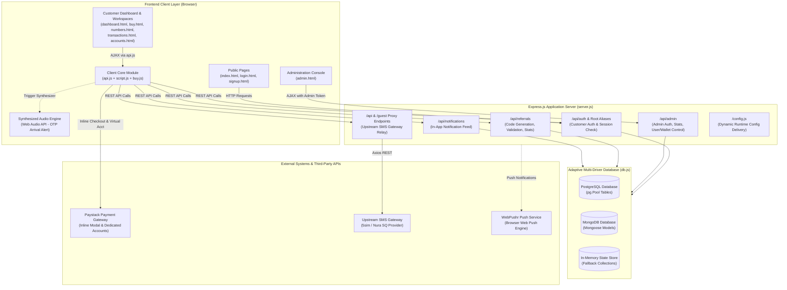
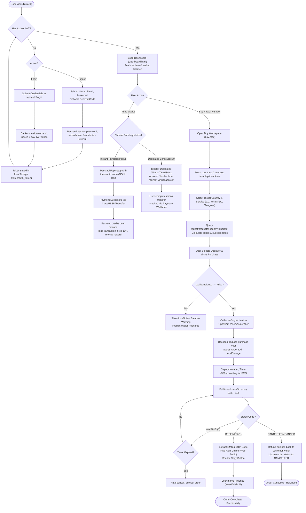
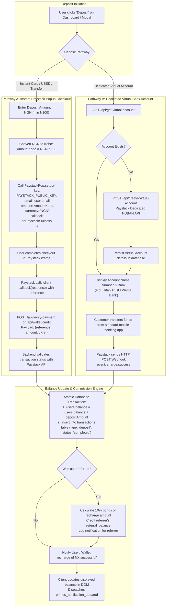
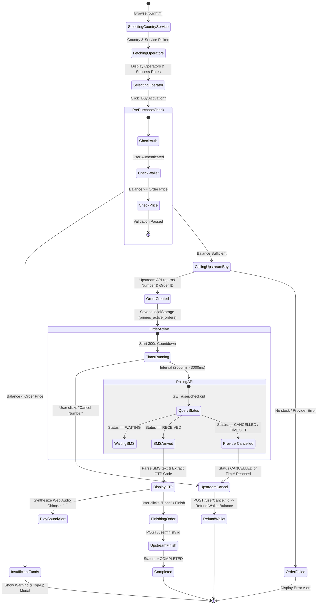
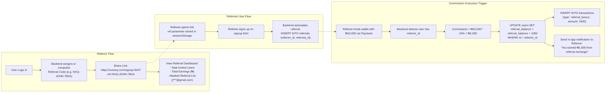
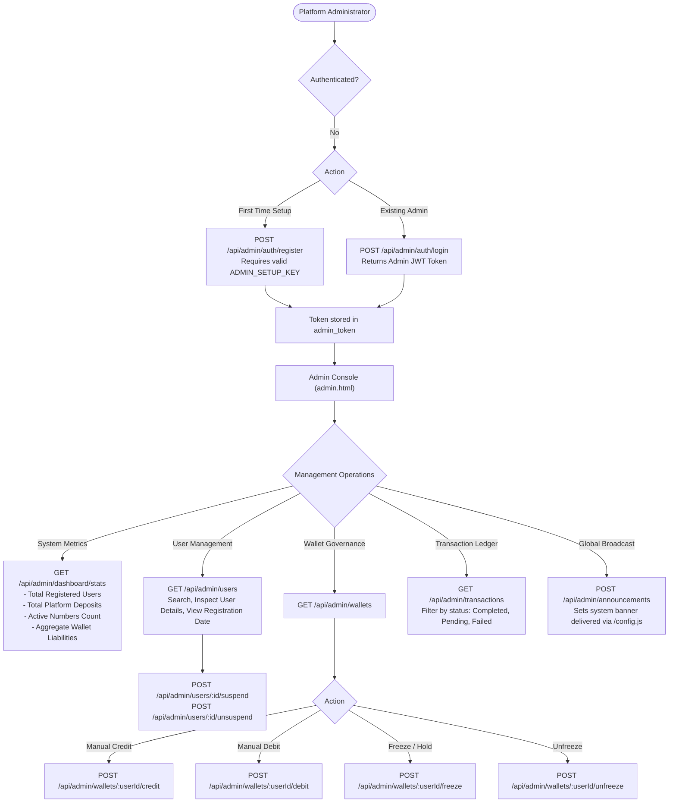
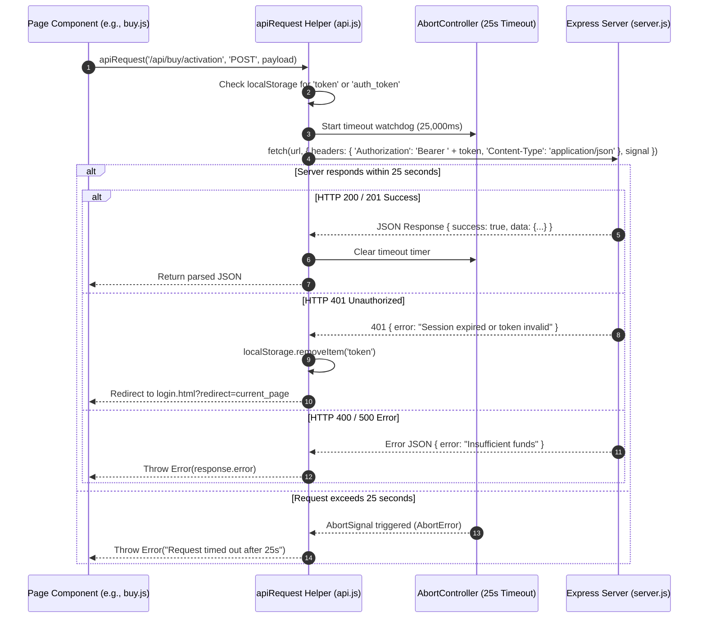
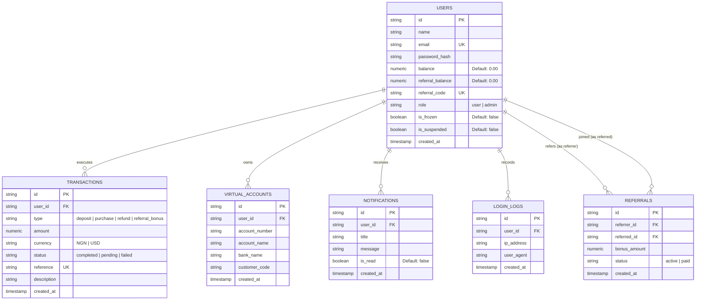

# NuraXQ System Architecture & Technical Flowchart Documentation

> **Role & Perspective:** Senior Software Architect & Full-Stack Systems Analyst  
> **Target Project:** NuraXQ Virtual Number & SMS Platform  
> **Document Status:** Complete Architecture Analysis & Verified Implementation Reference  
> **Specification Version:** 1.0.0  

---

## 1. Executive Summary & Project Overview

**NuraXQ** is a multi-tier web platform engineered for real-time virtual phone number provisioning, SMS/OTP verification, user wallet accounting, referral commission attribution, and administrative control.

The system connects end-users to upstream SMS aggregators (such as 5sim / Nura SQ upstream gateways) while abstracting provider pricing through localized Nigerian Naira (NGN) and US Dollar (USD) currency models, dynamic exchange rate conversions, and automated escrow balance management.

### Technology Stack Summary

| Layer | Technologies & Libraries |
| :--- | :--- |
| **Frontend Client** | HTML5, CSS3 (Modern Dark Theme, Glassmorphism), Vanilla ES6+ JavaScript, FontAwesome 6, Google Fonts (Plus Jakarta Sans, JetBrains Mono, Syne). |
| **Client Utilities** | `api.js` (Centralized Fetch Client, Token Storage, Fallback Handlers), `brand-logo.js` (Centralized SVG Branding), Web Audio API (Chime Synthesizer). |
| **Backend Runtime** | Node.js (v18+) with Express.js REST application server (`server.js`). |
| **Data Persistence** | **Triple-tier Adaptive Storage Engine** (`db.js`): 1. **PostgreSQL** via `pg.Pool` with auto-migration schema routines. 2. **MongoDB** via `mongoose.Schema` connection fallback. 3. **In-Memory Store** for development and zero-dependency deployments. |
| **Payment Gateway** | Paystack Standard API: Inline Popup Checkout (`PaystackPop.setup`) & Dedicated Virtual Bank Accounts (`/api/create-virtual-account`). |
| **SMS Aggregator Proxy** | Upstream REST API client (`fivesim.js`) proxying requests to upstream endpoints (`https://nuraxq.com/api` / `https://api.nuraxq.com/api`). |
| **External Push** | WebPushr Browser Push Notification integration snippet. |

---

## 2. High-Level System Architecture

The following diagram illustrates how external users, client frontend single-page interfaces, backend controllers, databases, payment gateways, and third-party SMS providers interact.

---

## 3. End-to-End Core System Flow

This flowchart documents the unified user journey: from authentication to wallet recharge, country/operator browsing, virtual number purchase, active OTP polling, and administrative settlement.

---

## 4. User Registration, Authentication & Session Lifecycle

NuraXQ relies on JSON Web Tokens (JWT) signed with `JWT_SECRET` (defaulting to a system fallback when unconfigured). The client library (`api.js`) automatically synchronizes authorization state across tabs using `localStorage`.

```mermaid
sequenceDiagram
    autonumber
    actor User as Client Browser
    participant API as Frontend Controller (api.js)
    participant AuthRoute as Express Auth Router (/api/auth)
    participant DB as Adaptive Database (db.js)

    %% Registration
    rect rgb(26, 31, 56)
    note right of User: Registration Flow
    User->>API: Enter Full Name, Email, Password, Referral Code
    API->>AuthRoute: POST /api/auth/signup {name, email, password, referralCode}
    AuthRoute->>DB: findUserByEmail(email)
    alt Email already registered
        DB-->>AuthRoute: Existing User Object
        AuthRoute-->>API: 400 Bad Request ("Email already registered")
        API-->>User: Display error message
    else Email is new
        AuthRoute->>AuthRoute: Hash password (bcrypt or PBKDF2 fallback)
        AuthRoute->>DB: createUser({id, name, email, password_hash, referral_code})
        opt Referral Code Provided
            AuthRoute->>DB: recordReferral(referrerUser.id, newUser.id)
        end
        AuthRoute->>AuthRoute: jwt.sign({id, email, name}, JWT_SECRET, {expiresIn: '7d'})
        AuthRoute-->>API: 201 Created {token, user}
        API->>API: localStorage.setItem('token', token)
        API-->>User: Redirect to dashboard.html
    end
    end

    %% Login
    rect rgb(31, 38, 70)
    note right of User: Login & Guard Flow
    User->>API: Enter Email & Password
    API->>AuthRoute: POST /api/auth/login {email, password}
    AuthRoute->>DB: findUserByEmail(email)
    AuthRoute->>AuthRoute: Verify password hash
    AuthRoute->>DB: logLogin(userId, ip, userAgent)
    AuthRoute->>AuthRoute: jwt.sign(userPayload, JWT_SECRET, {expiresIn: '7d'})
    AuthRoute-->>API: 200 OK {token, user}
    API->>API: localStorage.setItem('token', token)
    API-->>User: Redirect to dashboard.html
    end

    %% Session Validation
    rect rgb(40, 24, 60)
    note right of User: Protected Route Verification
    User->>API: Page Load (e.g., dashboard.html)
    API->>AuthRoute: GET /api/auth/me (Header: Bearer <token>)
    alt Token Valid
        AuthRoute->>DB: findUserById(decoded.id)
        AuthRoute-->>API: 200 OK {user: {id, name, email, balance, referral_balance}}
        API-->>User: Populate DOM elements with user profile & balance
    else Token Expired or Invalid
        AuthRoute-->>API: 401 Unauthorized
        API->>API: localStorage.removeItem('token')
        API-->>User: Force redirect to login.html?redirect=current_page
    end
    end
```

---

## 5. Wallet Funding & Payment Processing Architecture

The platform supports two wallet deposit mechanisms powered by Paystack:
1. **Paystack Inline Modal Popup**: Real-time deposit using debit cards, USSD, Apple Pay, or bank transfers.
2. **Dedicated Virtual Accounts**: Dedicated accounts (Wema Bank / Titan Trust Bank) dynamically generated per customer.

---

## 6. Virtual Number Purchase & SMS Activation Lifecycle

This lifecycle represents the core business logic of NuraXQ: selecting numbers, checking operator inventory, debiting customer wallets, and real-time polling for incoming SMS text messages.

---

## 7. Referral System Architecture & Commission Distribution

NuraXQ incorporates a viral referral engine designed to award active referrers a **10% instant commission** on all recharges executed by invited peers.

---

## 8. Administration Dashboard & Platform Governance

The admin portal (`admin.html` and `routes/admin.js`) allows administrators to monitor financial turnover, manage accounts, freeze suspicious wallets, and issue global announcements.

---

## 9. Client-Server API Communication Protocol

All client requests are marshaled through the centralized `apiRequest` utility in `api.js`. This module injects authorization headers, enforces a 25-second timeout controller, and handles token expiration redirects.

---

## 10. Data Model & Entity Relationship Diagram

The underlying data model in `db.js` defines the core entities, their relations, and key constraints across PostgreSQL and MongoDB implementations.

---

## 11. System Architecture Analysis & Engineering Recommendations

### A. Architectural Strengths
1. **Resilient Data Layer**: The database abstraction in `db.js` provides automatic fallback from PostgreSQL to MongoDB to In-Memory storage, allowing the server to boot under any infrastructure configuration.
2. **Centralized Frontend Client**: `api.js` centralizes token persistence, timeout limits, currency conversions, and API routing, minimizing code duplication across the UI pages.
3. **Double Redundancy in SMS Order Management**: Active numbers are persisted in `localStorage` (`primes_active_orders`), allowing orders to survive accidental browser reloads or tab closures without losing OTP timers.
4. **Instant Commission Engine**: Referrals are linked upon registration and rewarded automatically during recharges without requiring manual administrative processing.

### B. Identified Gaps & Production Recommendations

| Component | Current Implementation Observation | Recommended Architectural Hardening |
| :--- | :--- | :--- |
| **Payment Verification** | Client sends transaction reference to `/api/verify-payment` after Paystack popup callback. | Rely strictly on **Server-to-Server Paystack Webhooks** with cryptographic signature verification (`x-paystack-signature` HMAC SHA512) before balance credit to avoid client-side spoofing. |
| **System Announcements** | Announcements in `routes/admin.js` are held in process memory (`announcementState`). | Persist announcements to PostgreSQL / MongoDB table so they survive server restarts across clustered instances. |
| **Active Order Ledger** | Active orders and timer states rely primarily on browser `localStorage`. | Persist order records (`order_id`, `phone_number`, `expires_at`, `status`) in a database `orders` table to allow multi-device session continuity. |
| **Rate Limiting** | General endpoints do not currently enforce strict IP/user rate limiting. | Mount `express-rate-limit` on `/api/auth/login`, `/api/auth/signup`, and upstream proxy endpoints (`/api/buy/activation`) to mitigate brute-force and scraping attempts. |
| **Webhook Idempotency** | Webhook verification checks existing references in `transactions`. | Ensure strict database unique constraint on `transactions.reference` to guarantee zero double-crediting under network retries. |

---

*This document was generated through static analysis of the NuraXQ codebase (`server.js`, `db.js`, `routes/`, `fivesim.js`, `api.js`, `script.js`, `buy.js`, `admin.js`).*
